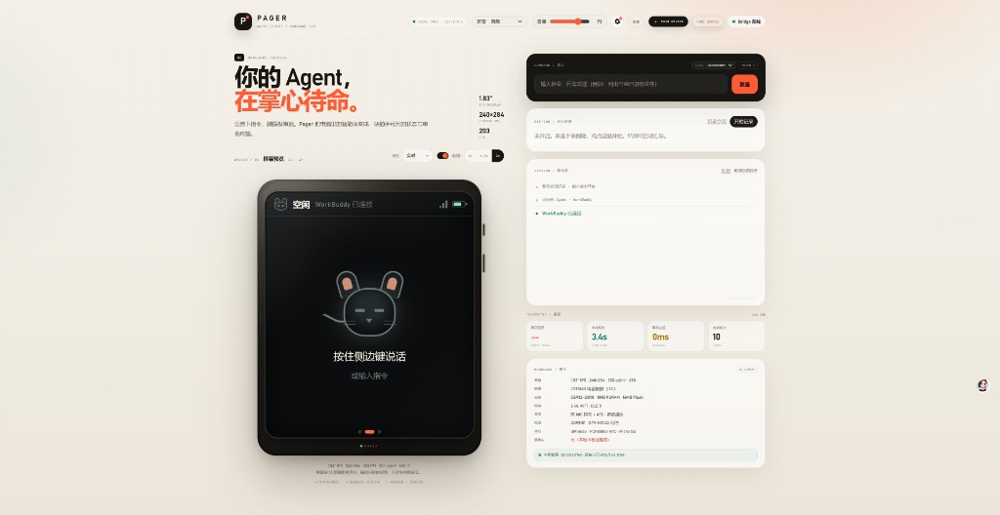
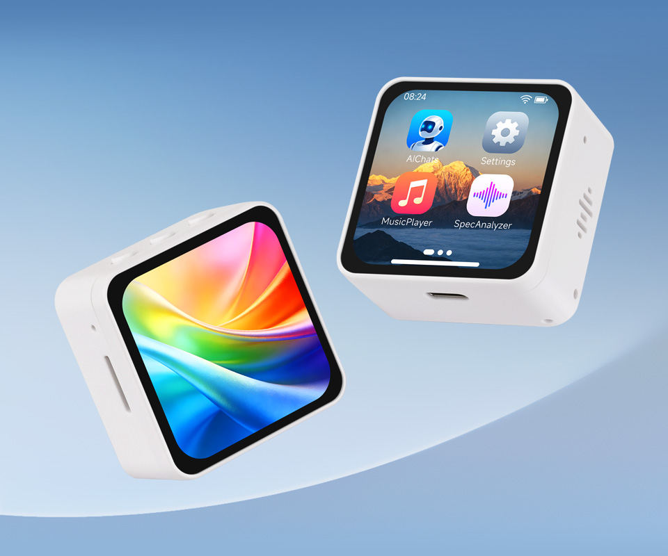
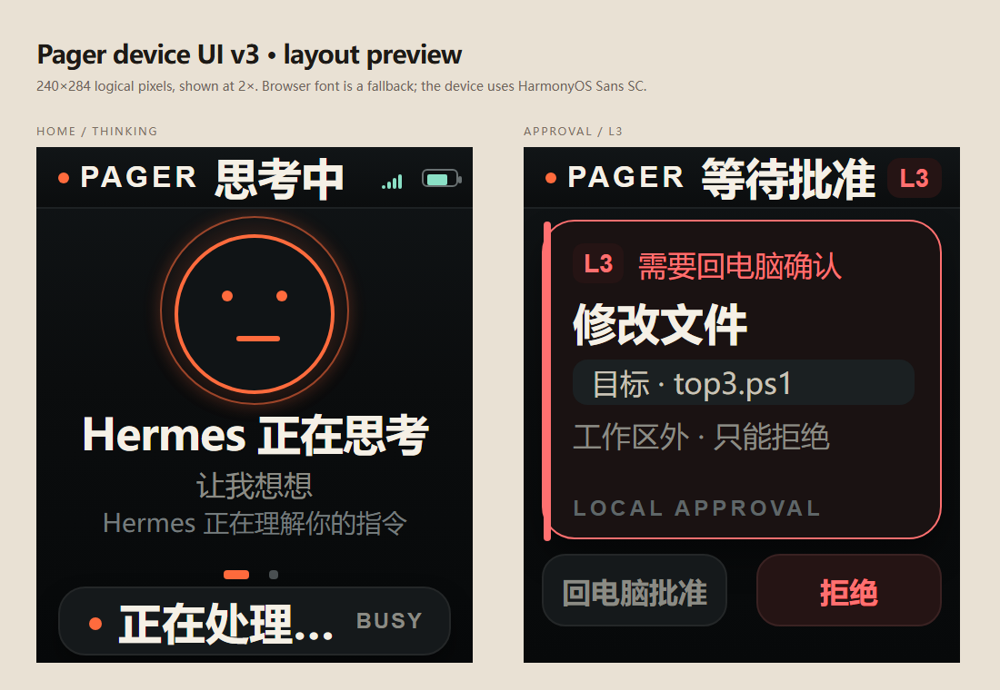
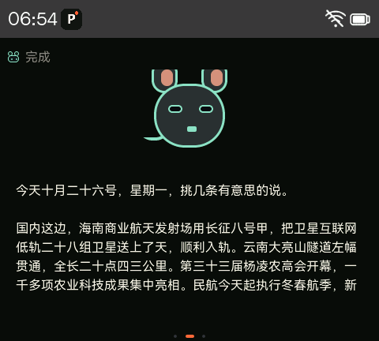
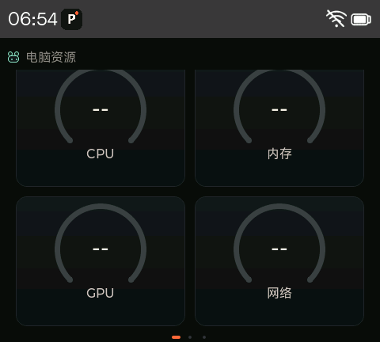
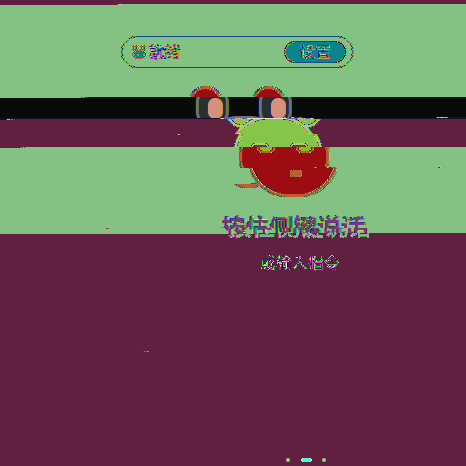
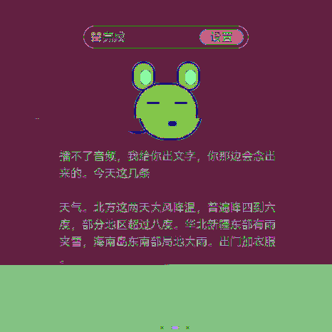
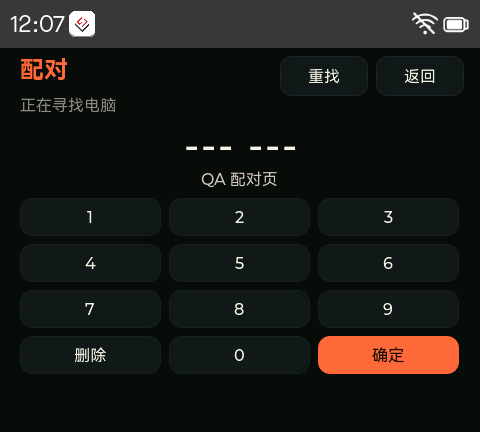

# ESP32 Pager — Open-source AI Agent Watch + PC Bridge

[简体中文](README_ZH.md)

**MIT 开源**（中文说明见 [README_ZH.md](README_ZH.md)）：任何人可自由使用、修改与分发。本项目将 Waveshare ESP32-S3 AMOLED 开发板变成可语音对话、审批 AI 指令、查看电脑资源的「Pager」手表，并通过 Windows 上的 **Pager Bridge** 连接 Hermes、Cursor、Codex、Claude、WorkBuddy 等 ACP 智能体。

> 固件上游基于 [Waveshare ESP32-S3-Touch-AMOLED-2.16 官方仓库](https://gitee.com/waveshare/ESP32-S3-Touch-AMOLED-2.16)（见 [docs/WAVESHARE_README.md](docs/WAVESHARE_README.md)）。圆屏 1.75C 为同系列 BSP + 本地补丁（[ROUND_BSP_PATCH.md](examples/esp-idf/03_esp-brookesia/patches/ROUND_BSP_PATCH.md)）。

---

## 界面预览

### PC Web 管理端（Agent Center）

本地浏览器打开 `http://127.0.0.1:8765/`：配对、发指令、看会话与主机指标；左侧设备预览与手表三页 UI 一致。



### 支持的开发板（Waveshare AMOLED）



### 手表端 UI（与 Web 对齐）

设计预览：



**2.16" 方屏（480×480）真机** — 主页 / 电脑资源：

<p>
  
  
</p>

**1.75C 圆屏（466×466）真机** — 主页 / 审批：

<p>
  
  
</p>

配对流程：



更多截图见 [docs/gallery/](docs/gallery/) 与 [docs/pager/assets/](docs/pager/assets/)。

---

## 支持的硬件

| Git 分支 | 开发板 | 屏幕 | PTT 侧键 | 备注 |
|----------|--------|------|----------|------|
| **`main`** | [ESP32-S3-Touch-AMOLED-2.16](https://www.waveshare.com/esp32-s3-touch-amoled-2.16.htm) | 480×480 方屏，CO5300 QSPI | GPIO18，**低电平有效** | 默认 Waveshare 2.16 示例树 |
| **`round-amoled-1_75c`** | [ESP32-S3-Touch-AMOLED-1.75C](https://www.waveshare.com/) | 466×466 圆屏 | GPIO3，**高电平有效** | 需 AXP2101 上电（`pager_pmu.c`）、DMA buffer 等补丁 |

共同外设：CST9217 触控、ES7210 + ES8311 音频、Wi-Fi。烧录工程路径：

`examples/esp-idf/03_esp-brookesia`

---

## 功能概览

### 手表端（ESP-IDF + LVGL + ESP-Brookesia）

- 三页 UI（与 Web 端对齐）：**主页**（Agent 状态、主机 CPU/内存/GPU/网速环）、**审批页**、**设置**
- Wi-Fi 配网、与 PC **6 位配对码**、TLS **WSS** 长连接
- **PTT 按住说话** → 发送到 PC 转写 → 作为指令发给当前 Agent
- **L0–L3 风险分级**：L2 可在手表批准/拒绝；L3 仅 PC 可批准
- 上滑返回 Brookesia 启动器；顶部状态药丸（Wi-Fi、电量等）

### PC 端（`bridge/` — Python FastAPI）

- **127.0.0.1:8765** — 本地 Web 管理 UI（HTTP，不暴露局域网）
- **0.0.0.0:8766** — 设备配对与认证 **WSS**（TLS，默认自签证书）
- 多 **Agent Profile**（ACP）：Hermes / Cursor / Codex / Claude / WorkBuddy（需本机自行安装对应客户端）
- 离线 **Faster-Whisper** 语音转写（模型约 1.4GB，**不在 Git 中**，安装脚本或自行下载）
- 回复 **Edge-TTS** 或 Windows **SAPI**
- 主机遥测：`psutil` + `nvidia-smi`（可选）

**不包含在仓库内**：各 Agent 的安装包、账号登录态、你的聊天记录/会议记录/审计日志（打包脚本会剔除）。

---

## 快速开始

### 1. 固件

1. 安装 [ESP-IDF 5.5.x](https://docs.espressif.com/projects/esp-idf/)
2. 克隆本仓库并切换到对应硬件分支：`main` 或 `round-amoled-1_75c`
3. 进入 `examples/esp-idf/03_esp-brookesia`，执行 `idf.py set-target esp32s3 build flash monitor`
4. 更多硬件说明见 [docs/HARDWARE.md](docs/HARDWARE.md)

### 2. PC Bridge（Windows 10/11）

```powershell
git clone https://github.com/LjfsGitHub/esp32-pager.git
cd esp32-pager\bridge
pip install -e .
python -m pager_bridge.serve
```

浏览器打开 **http://127.0.0.1:8765/**。Agent 路径在 `bridge/agents.json` 中配置（已使用 `%LOCALAPPDATA%`、`%USERPROFILE%`、`%ProgramFiles%` 等变量）。详见 [docs/BRIDGE.md](docs/BRIDGE.md)。

### 3. 配对手表

1. PC 与手表在同一 2.4GHz Wi-Fi
2. Web UI 生成 **6 位配对码**
3. 手表输入配对码，完成后自动 WSS 连接

---

## 仓库结构

| 路径 | 说明 |
|------|------|
| `examples/esp-idf/03_esp-brookesia/` | Pager 固件与 Brookesia 示例 |
| `examples/.../components/brookesia_app_pager/` | Pager 应用核心 |
| `bridge/` | PC Bridge（Python 包名 `pager_bridge`） |
| `pager_workspace/` | Agent 工作区（空目录占位） |
| `docs/pager/` | 联调、验收、打包说明 |
| `qa/` | 可选串口/截图回归脚本 |

---

## 打包与隐私

发布 zip 时使用 `bridge/scripts/build-package.ps1`；脚本会**删除**审计日志、会话转写、会议 JSON、WorkBuddy 凭据密钥，并重置 `devices.json`。详见 [docs/pager/PACKAGING.md](docs/pager/PACKAGING.md)。

---

## 贡献

欢迎 Issue 与 Pull Request。请勿提交含个人路径、API Key、设备 token 或聊天/会议记录的变更。

---

## 致谢

- [Waveshare](https://www.waveshare.com/) 硬件与示例代码  
- [Espressif ESP-IDF](https://github.com/espressif/esp-idf)、[LVGL](https://lvgl.io/)、[ESP-Brookesia](https://github.com/espressif/esp-brookesia)  
- 各 Agent 产品名称归其各自所有者所有
