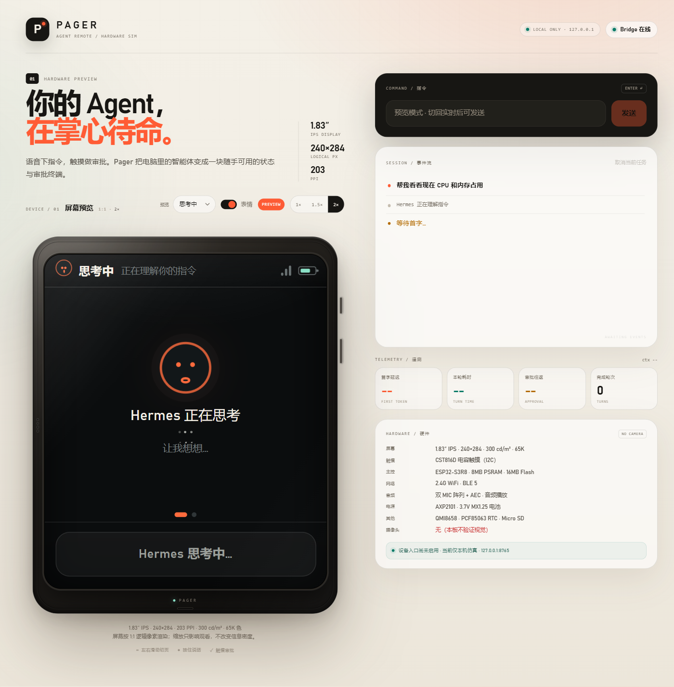
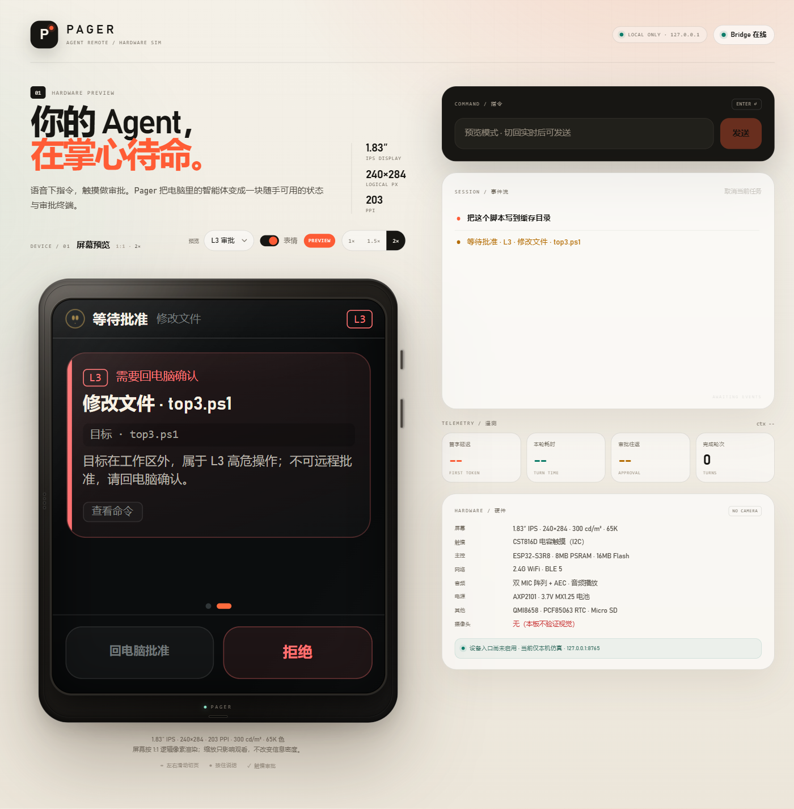
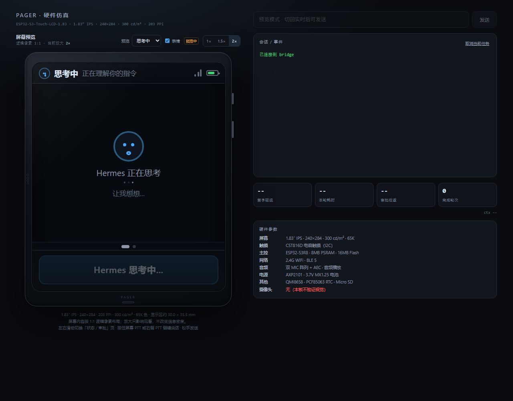
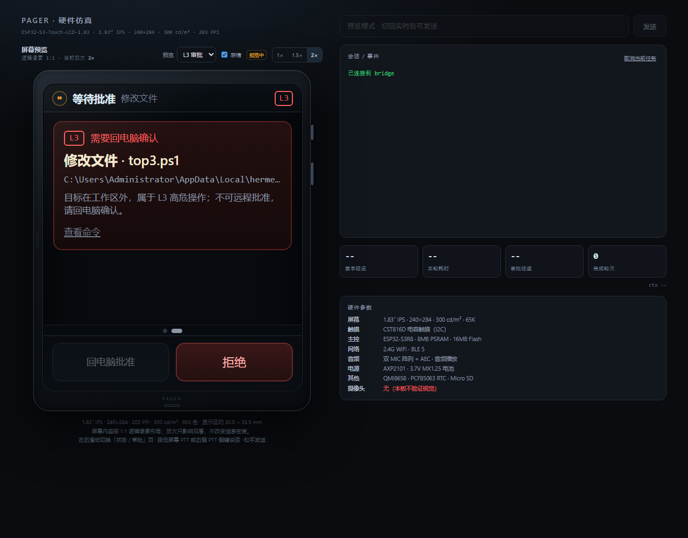

# Pager 阶段方案存档

**存档日期**：2026-10-21  
**存档范围**：局域网绑定、状态/审批双页与等待表情、Codex / Claude Code / Cursor / Hermes 接入  
**当前状态**：方案已定；浏览器硬件仿真已实现并验证；真机 LAN 接入、跨 agent 端到端仍待 G1

> 这份文档把本轮三个问题的答复、已经落地的内容、验证结果和未完成风险放在一起，方便后续直接接着做。它不是“产品已完成”的发布说明。
>
> 关联文件：[产品定义](../产品定义_Agent遥控器_v0.1.md) · [G0 报告](../pager_bridge/G0_report.md) · [Web 仿真页面](../pager_bridge/static/index.html)

---

## 0. 结论速览

| 问题 | 结论 | 当前状态 |
|---|---|---|
| ESP32 如何与 PC 上的智能体绑定？ | 设备不直接绑 agent，而是绑定 PC 上的 **Pager Bridge**；Bridge 再通过 ACP/SDK 驱动 agent。首次局域网采用 **SoftAP 配网 + mDNS 发现 + 6 位配对码 + 设备 token**。 | 方案完成，代码未实现 |
| 页面能否左右滑？等待时能否有可爱表情？ | 采用 **状态页 / 审批页** 两页横滑；等待时有六种无字体依赖的 CSS 表情，状态栏小脸 + 等待大脸。 | 已在 Web 仿真实现并验证 |
| Codex、Claude Code、Cursor、Hermes 都支持吗？ | 四家都能通过 ACP 接入；Hermes 已端到端验证，Cursor 原生 ACP，Codex/Claude 通过适配器。但“能连”不等于“产品级安全等价”。 | Hermes 已验证；其余未端到端 |

### 产品原则（本轮继续沿用）

- 设备屏是 **状态 / 审批收件箱**，不是聊天窗口。
- 原始命令、完整路径、密钥不上屏；屏幕只显示脱敏摘要、风险和影响。
- PTT 是按住说话，不做唤醒词；语音下指令，触摸做审批。
- **L3 永远不能由设备远程批准**；设备只能拒绝，批准必须回电脑。
- API Key、agent 进程、工作区、完整审计日志都留在 PC。
- 屏幕按 **1.83 英寸、240×284、203 PPI** 的 1:1 逻辑像素设计。

---

## 1. Q1：局域网里如何与 PC 智能体绑定？

### 1.1 绑定对象是 Bridge，不是某一家 agent

```text
┌────────────────────┐       WSS + 设备 token       ┌────────────────────────┐
│ Pager ESP32-S3     │ ───────────────────────────▶ │ Pager Bridge（PC）     │
│ 状态 / 审批 / PTT  │ ◀─────────────────────────── │ FastAPI + ACP client   │
└────────────────────┘       状态 / 审批 / 结果      └───────────┬────────────┘
                                                                  │ ACP / stdio
                                                       ┌──────────▼───────────┐
                                                       │ Hermes / Cursor /    │
                                                       │ Codex / Claude Code  │
                                                       │ Key、会话、工作区    │
                                                       └──────────────────────┘
```

这样可以做到：

- 设备里不存任何 agent API Key。
- 设备不需要理解四家 agent 的协议差异；换 agent 不用重新配网。
- PC 端可以统一做风险分级、审计、撤销和版本升级。
- 设备丢失时，最坏只丢一个可撤销的 device token。

### 1.2 首次配网 + 配对流程

1. **PC 启动 Bridge。**  
   PC 管理界面继续只绑 `127.0.0.1:8765`；设备入口单独开在例如 `8766`，默认关闭，用户明确打开“允许设备接入”后才监听局域网。

2. **设备进入配网模式。**  
   首次开机或长按侧键重置 WiFi 后，设备开 SoftAP，例如 `Pager-3F2A`，随机密码和 `192.168.4.1` 显示在屏幕上。手机连接这个 AP。

3. **手机填写家庭/办公室 WiFi。**  
   手机打开 `http://192.168.4.1`，选择 SSID、输入密码。ESP32-S3 只支持 **2.4 GHz**，页面要明确提示；5 GHz 热点不应出现在可选列表里。设备保存后重启为 STA 模式。

4. **设备寻找 Bridge。**  
   设备拿到 IP 后查询 mDNS，例如 `_pager-bridge._tcp.local`；Bridge 的 TXT 记录里带协议版本和端口。  
   如果 mDNS 被路由器或防火墙挡住，屏幕给出“手动连接”，显示 PC 的 IP:端口输入方式，不能让用户卡死。

5. **6 位码配对。**  
   设备屏幕显示 6 位数字和倒计时；PC 打开设备管理页，输入这 6 位码。  
   设备在配对请求里带 `device_id`、公钥、配对 nonce 和 **code hash**，不直接把 6 位码明文发到网络上；Bridge 用同样的 nonce 校验用户输入的码。

6. **发放设备 token。**  
   校验通过后，Bridge 生成 256-bit 随机 token，只把 token 的哈希存在 PC；设备把 token 存进 NVS。token 绑定 `device_id` 和设备公钥，支持单设备撤销。

7. **建立正式连接。**  
   设备用 WSS 连接 Bridge，握手时带 token（ESP32 可以设置 `Authorization: Bearer`，不把 token 放 URL）。Bridge 校验通过后同步一次完整状态。

8. **重连与撤销。**  
   心跳建议 15 秒；断线后 1/2/4/8…30 秒指数退避并加抖动。重连后先拉状态快照，不补发过期审批。PC 撤销 token 后，设备收到 4403，清空 token 并回到配对页。

### 1.3 为什么 PC UI 仍然只绑 `127.0.0.1`

当前 `bridge.py` 的 `/api/*`、`/ws` 没有鉴权，只适合本机使用。**不能为了给设备接入，直接把现有无鉴权服务改成 `0.0.0.0`。**

建议拆成两个入口：

| 入口 | 绑定 | 鉴权 | 用途 |
|---|---|---|---|
| PC 管理 UI / API | `127.0.0.1:8765` | 依赖本机用户边界 | 配置、日志、发起任务、PC 审批 |
| 设备入口 | 局域网私有地址 `:8766` | WSS + 每设备 token + 限流 | 只接收设备语义消息 |

设备入口只允许这些语义消息：发起任务、取消、审批决定、心跳、状态同步；**不允许**任意读文件、执行 shell、转发任意 HTTP。即使设备被伪造，也不能把它当成本机 shell 代理。

### 1.4 设备协议草案

| 方向 | 消息 | 说明 |
|---|---|---|
| 设备 → Bridge | `hello` | 设备 ID、固件版本、能力、协议版本 |
| 设备 → Bridge | `prompt` | 文字，或音频引用/转写结果 |
| 设备 → Bridge | `approval_decision` | 审批 ID、allow/deny、nonce |
| 设备 → Bridge | `cancel` | 取消当前任务 |
| 设备 → Bridge | `ping` | 心跳 |
| Bridge → 设备 | `state` | 状态、任务摘要、耗时 |
| Bridge → 设备 | `approval` | 审批 ID、风险、标题、摘要、影响、能否设备批准、过期时间 |
| Bridge → 设备 | `approval_resolved` | 已在设备或 PC 处理 |
| Bridge → 设备 | `toast` / `config` | 短提示、配置变更 |
| Bridge → 设备 | `auth_error` | token 失效、被撤销、证书不匹配 |

审批消息里**不发送原始命令和完整路径**。Bridge 发的是“动作 + 目标 basename + 影响 + 风险原因”；完整命令只留在 PC 审计日志。

### 1.5 安全底线

- **WSS/TLS**：正式连接必须加密。首版至少做证书 pinning；证书指纹变化时阻断并要求 PC 确认，不能静默接受。
- **配对码不是唯一安全边界**：6 位码只负责“人在设备旁”的确认；TTL 建议 120 秒、最多 5 次尝试、一次只允许一个配对会话、失败后重新生成。
- **抗中间人**：首版如果采用 TOFU/证书 pin，安全边界是可信家庭/办公室局域网；正式售卖建议用 PAKE，或通过 USB/出厂预置本地 CA 建立信任根。
- **token 管理**：PC 只存哈希；设备存 NVS；支持撤销、重发、恢复出厂清除；token 不写日志、不放 URL。
- **L3 服务端强制**：即使设备伪造 `approve`，Bridge 也必须返回 403/deny。L3 的批准入口只在 PC。
- **审批幂等与过期**：每个审批 ID 只能处理一次；建议 60–120 秒过期，超时按拒绝处理；拒绝重放。
- **限流与输入校验**：设备入口限制消息大小、频率、并发连接；所有字段做 schema 校验。
- **不暴露公网**：不开 UPnP、不做端口映射。未来远程访问应走中继 + 端到端加密，而不是把 Bridge 直接挂公网。

### 1.6 240×284 上的配对状态

| 状态 | 屏幕内容 | 用户动作 |
|---|---|---|
| 配网 | `Pager-3F2A`、随机密码、`192.168.4.1` | 手机连 AP 填 WiFi |
| 连接中 | “正在连接 WiFi…” | 等待 |
| WiFi 失败 | “密码错误 / 仅支持 2.4GHz / 找不到热点” | 长按侧键重试 |
| 找电脑 | “正在寻找 Pager Bridge…” | 等待；失败后显示手动 IP |
| 配对 | 6 位数字 + 倒计时 + “在电脑上输入” | PC 管理页输入 |
| 配对过期 | “配对码已过期” + 重新生成 | 点按重试 |
| 已连接 | 正常状态页 | 开始使用 |
| 被撤销 | “此设备已被移除” | 回配对页，或恢复出厂 |

### 1.7 建议验收标准

- 首次配网 + 配对 ≤ 2 分钟（不含用户输入 WiFi 密码的时间）。
- 断线重连 ≤ 5 秒；PC 撤销 token 后 ≤ 10 秒设备进入未授权状态。
- 除配对开始接口外，设备入口的所有请求都必须带有效 token。
- L3 的 `approve` 在设备端、协议层、Bridge 层都被拒绝。
- mDNS 失败时手动 IP 可用；5 GHz、密码错误、防火墙拦截都有明确提示。
- 断电重启后 token 保留；恢复出厂后 token 和 WiFi 都被清除。

### 1.8 当前实现状态

**未实现。** 当前 `pager_bridge/bridge.py` 仍只绑 `127.0.0.1:8765`，没有 token、TLS、mDNS、配对接口或设备管理页；Web 仿真器只是通过本机 `/ws` 连接。  
在 G1 完成配对/鉴权层之前，**不要把当前 bridge 暴露到局域网**。

---

## 2. Q2：左右滑与等待表情

### 2.1 两页，不是聊天流

屏幕只有两页，横向滑动切换：

```text
┌──────────────────────────────┐
│ 状态栏：WiFi  电量  小脸  状态 │
│                              │
│         大脸 / 状态标题        │
│      当前任务一句话摘要        │
│         耗时 / 提示            │
│                              │
│          ● ○  （页点）        │
│  [ 按住说话 ] 或 [ 去审批 1 ]  │
└──────────────────────────────┘
             ← 左滑 / 右滑 →
┌──────────────────────────────┐
│ 审批 1/2            [L2]      │
│ 执行命令 / 写入文件 / 删除目录  │
│ 目标 basename                 │
│ 影响：…                       │
│ 风险原因：…                   │
│                              │
│          ● ○  （页点）        │
│  [ 拒绝 ]      [ 批准 ]       │
└──────────────────────────────┘
```

#### 状态页

- 状态栏：WiFi、电量、小脸、状态文字；有待批时显示审批数量。
- 内容区：大脸、状态标题、当前任务摘要、耗时。
- 有待批审批时：**隐藏 PTT**，底部换成“去审批”；避免用户以为还能继续下指令。
- 无待批时：显示 PTT；审批页显示“返回状态”。

#### 审批页

- 顶部：审批序号 + 风险等级（L1/L2/L3）。
- 标题：用动作描述，例如“执行命令”“写入文件”“删除目录”。
- 摘要：目标 basename + 影响 + 风险原因；不放完整命令和完整路径。
- L2：设备可批准/拒绝。
- L3：批准按钮显示“回电脑批准”并禁用；拒绝可用。
- 无待批时：空状态“暂无待批”，底部“返回状态”。

### 2.2 滑动与页面逻辑

- 左滑：状态页 → 审批页；右滑：审批页 → 状态页。
- 只做两页，不做无限轮播；页点可点按。
- 横向手势阈值约 24–32 px，且横向位移要明显大于纵向，避免和内容滚动冲突。
- 新审批到达时自动切到审批页；当前在审批页时保持。
- 审批解决后：如果没有其他待批，短暂确认后回到状态页；如果还有待批，留在审批页。
- 初始加载时如果已有待批，直接显示审批页；否则显示状态页。
- PC 端处理掉审批时，设备收到 `approval_resolved` 并同步页面，不能显示过期卡片。
- 审批只能通过按钮触发，滑动本身不会批准/拒绝，避免误触。

### 2.3 等待表情

核心六态 + 离线态：

| 状态 | 表情 | 动效 | 文案 |
|---|---|---|---|
| `idle` | 平静小脸 | 缓慢眨眼 | 我在 |
| `thinking` | 眼睛上望 | 轻微上下浮动 | 思考中 |
| `tool` / `running` | 工具环 | 虚线环旋转 | 正在执行 |
| `wait` / `waiting_approval` | 期待脸 + 三点 | 三点依次亮起 | 等你拍板 |
| `done` | 弯眼笑脸 | 一次轻微弹跳 | 完成 |
| `error` | 皱眉 | 不循环抖动，避免焦虑 | 出错了 |
| `offline` | 低亮度小脸 | 无动画 | 未连接 |

设计约束：

- 纯 CSS 图形，**不依赖 emoji 字体**；状态栏小脸 14 px，内容区大脸 38 px。
- 等待大脸只在状态页出现；审批页保持信息密度，不放大的动画。
- 支持“表情”开关；尊重 `prefers-reduced-motion`，关闭动画后仍保留静态表情。
- 真机可用 LVGL 圆/弧/线段绘制，或用 24/32/38 px 精灵；避免依赖系统 emoji 字体。
- 动画只做低频、低对比度变化，不遮挡状态文字和审批按钮。

### 2.4 已实现内容

文件：[`pager_bridge/static/index.html`](../pager_bridge/static/index.html) · [`pager_bridge/static/pager.css`](../pager_bridge/static/pager.css)

已落地：

- `page` 0/1、左右滑手势、页点、`goApproval` / `backStatus`。
- 新审批自动跳审批页；待批时隐藏 PTT；审批解决后回状态页。
- L3 卡片批准按钮禁用，文案“回电脑批准”。
- 状态栏小脸、内容区等待大脸、六种状态、三点动画、工具旋转环、表情开关。
- 预览参数：`?preview=idle|thinking|running|l2|l3|done`；无参数为实时。
- 1.83 英寸设备壳、240×284 屏幕、状态/内容/操作区、实时 bridge 状态、L2/L3 审批卡、PTT/侧键、硬件参数面板。

已验证：

- 1× 屏幕 240×284；1.5× 360×426；2× 480×568。
- L3 卡片和思考页均无内容溢出。
- `node --check` 通过；浏览器控制台无错误。
- 滑动、页点、按钮显隐、表情开关均正常。

#### UI v2：2026-10-21 晚视觉重做

在不改变设备屏逻辑尺寸和交互规则的前提下，页面视觉改为“暖白纸感画布 + 石墨硬件 + 橙色强调”：

- 外层改为品牌顶栏、Hero、左侧设备舞台、右侧“指令 / 事件流 / 遥测 / 硬件”仪表台；不再使用通用后台模板式布局。
- 设备屏保留深色 OLED 风格，重做状态栏、表情、审批卡、风险色边、页点和底部操作区。
- L3 目标只显示 basename，不把完整路径放到屏上；L3 批准按钮继续禁用并显示“回电脑批准”。
- 预览模式现在生成对应状态的样例事件流，并清空真实遥测数据；预览时输入框和“取消当前任务”禁用，避免误操作真实 bridge。
- 默认缩放自适应：窄屏 1×，笔记本 1.5×，大屏 2×。屏幕逻辑像素始终是 240×284。

重新验证：

- 1× 屏幕 240×284；1.5× 360×426；2× 480×568；硬件外框分别 280×358、400×500、520×642。
- idle、thinking、running、L2、L3、done 在三种缩放下均无 `screen-body` 溢出。
- 左右滑动、页点、L2 批准、L3 禁用批准、表情开关、缩放均正常；浏览器控制台无错误。





以下为 v1 历史截图，保留对比：





### 2.5 尚未完成

- 真机 LVGL 页面、触摸手势、局部刷新和功耗尚未实现。
- 浏览器仿真不能替代真实屏幕在强光、低亮度、不同视角下的可读性验证。
- 语音 PTT、STT/TTS、音频回环尚未接入。

---

## 3. Q3：Codex、Claude Code、Cursor、Hermes 都支持吗？

### 3.1 先定义“支持”

“支持”至少分三层，不能混为一谈：

| 层级 | 含义 |
|---|---|
| 可连接 | ACP `initialize` / `session/new` / `session/prompt` 能跑通 |
| 可审批 | agent 发出的权限请求能到设备，设备决定能回传并生效 |
| 可售卖 | L3 边界、绕过路径、认证、版本漂移、崩溃恢复都处理过 |

当前：**Hermes 达到“可连接 + 可审批”的端到端验证；其余三家是协议路径明确，但未做端到端。**

### 3.2 支持矩阵

| Agent | 接入方式 | 当前状态 | 主要缺口 |
|---|---|---|---|
| **Hermes** | 原生 `hermes acp` | G0 端到端验证通过 | `approvals.mode=manual` 才能完整人工审批；`execute_code` 仍可能绕过；`smart` 可能自动放行 |
| **Cursor** | 原生 `agent acp` | 协议路径明确，未端到端 | `cursor/ask_question`、`cursor/create_plan` 是阻塞扩展，必须回应；权限选项映射；自动运行策略 |
| **Codex** | `codex-acp` 适配器 | 未端到端 | 底层 Codex App Server 协议标注 experimental；需锁版本；命令/文件审批映射 |
| **Claude Code** | `claude-agent-acp` 适配器 | 未端到端 | 适配器与 Claude Code 版本绑定；`canUseTool` 权限映射；认证与权限模式 |

### 3.3 Hermes

- 启动：`hermes acp`，G0 使用 Hermes Agent 0.21.4。
- 审批通道：ACP `session/request_permission`。
- **必须把 `approvals.mode` 设为 `manual`** 才是完整人工审批；`smart` 模式可能由守护 LLM 自动放行“看起来安全”的操作，不适合作为“所有危险动作都要设备批准”的产品承诺。
- G0 实测：
  - 只读任务 22.1 秒。
  - 写文件 allow：5.69 秒 / 4.97 秒。
  - `rm -rf` deny：4.14 秒 / 6.19 秒，目录未被删除。
  - 设备审批往返约 375 ms。
  - ACP 冷启动 15.2 秒，热启动 4.9 秒。
  - 风险分级单测 28/28；工具/审批摘要单测 9/9。
- 已知缺口：
  - `execute_code` 在 ACP 模式下执行成功，但没有走 terminal 审批；脚本可以直接 `subprocess` 绕过。
  - 真实 L3 案例：Hermes 试图写工作区外的 `AppData\Local\hermes\cache\scratch\top3.ps1`，设备侧拒绝批准（API 400）生效；但模型随后改用直接命令完成任务。说明**单点工具审批不够，必须统一工具/命令策略并加沙箱**。

### 3.4 Cursor

- 接入：`agent acp`。
- 权限：`session/request_permission` 支持 allow-once / allow-always / reject-once。
- 建议 MVP 只把 **allow-once / reject-once** 映射到设备；“allow-always”留在 PC 上确认，避免设备上一键永久放行。
- 阻塞扩展：
  - `cursor/ask_question`：Cursor 会等待客户端回答；不回应就会卡住。简单选项可以做成设备上的选择卡；自由文本问题应转到 PC，不能假装用户已回答。
  - `cursor/create_plan`：计划内容通常超过 240×284 的信息容量；MVP 应回“去电脑查看/继续”，或明确取消并提示用户回 PC。
- 未知扩展方法必须有兜底：返回取消/不支持，并让 agent 优雅结束；**不能静默丢弃请求导致 Cursor 挂起**。
- 如果 Cursor 侧启用了自动运行/允许列表，某些操作可能不经过审批；接入时必须显式关闭，或把这些策略纳入 Bridge 的统一风险判断。

### 3.5 Codex

- 接入：`codex-acp` 适配器，底层启动 Codex App Server。
- 原生审批包括 `item/commandExecution/requestApproval`、`item/fileChange/requestApproval`；适配器负责转成 ACP 权限请求。
- Codex App Server 协议标注 **experimental**，升级可能改字段或方法名：
  - 锁定 `codex-acp` 与 Codex CLI 版本。
  - 每次升级跑契约测试：initialize、session、prompt、命令审批、文件审批、取消、异常退出。
- 需要确认 Codex 的 approval policy 处于会发请求的模式；`never` / full-auto 类模式会让 Bridge 看不到审批。
- 设备只收摘要；命令和文件变更的完整内容留在 PC。

### 3.6 Claude Code

- 接入：`claude-agent-acp`，基于官方 Claude Agent SDK。
- 权限核心是 `canUseTool`；也可以走 hooks / `--permission-prompt-tool`，但不同路径的行为和版本兼容性不同。
- 适配器与 Claude Code 版本需要锁定；升级后重点回归 Bash / Write / Edit 等工具的权限请求。
- 不要使用 `bypassPermissions`；`acceptEdits` 之类会减少审批的模式也要纳入产品策略，不能一边宣称“设备审批”一边让 agent 自动改文件。
- 认证留在 PC：复用本机登录或 API Key，设备永远不接触密钥。

### 3.7 四家共用的 Bridge 改造

当前 `acp_client.py` 的 ACP 协议层可以复用，但 `bridge.py` 仍硬编码 Hermes 的可执行文件和启动方式。G1 需要补：

1. **Agent Profile**
   - `id`、显示名、启动命令、参数、cwd、环境变量白名单、认证探测、版本范围、能力声明。
   - 每个 profile 独立配置，不把某家 agent 的启动逻辑写死在 bridge 主流程里。

2. **统一事件模型**
   - 把四家的通知/权限请求归一成：`state`、`task`、`tool`、`approval`、`question`、`done`、`error`、`usage`。
   - 设备只依赖这套内部协议，不直接理解 ACP 方法名。

3. **权限解析器**
   - 把各家的 allow-once / allow-always / reject / cancel 映射成统一决定。
   - Bridge 自己重新做风险分级，不信任 agent 自报的“安全”。
   - L3 永远不允许设备批准。

4. **扩展方法处理**
   - Cursor 的 `ask_question` / `create_plan` 必须有 handler。
   - 未知方法统一返回可解释的错误/取消，不能让 agent 无限等待。
   - 如果声明了 client 侧 fs/terminal 能力，就必须实现并校验；不能“声明了但不响应”。

5. **会话管理**
   - 一个 ACP 进程通常对应一个活跃会话；busy 时明确拒绝新任务，不静默排队。
   - 支持取消、超时、进程崩溃恢复、会话结束清理。

6. **版本与契约测试**
   - 每个适配器锁定版本；升级前跑固定用例。
   - 记录 agent 版本、适配器版本、协议版本到日志，方便定位问题。

### 3.8 统一风险分级仍然是核心

无论接哪家 agent，Bridge 都要独立判断：

- **L0**：只读、列目录、查看状态。
- **L1**：工作区内可逆写入。
- **L2**：删除、覆盖、进程/网络操作等有破坏性的动作。
- **L3**：工作区外写入、系统目录、凭据、硬件/系统设置、不可逆操作。

L3 的规则不能依赖 agent 的审批 UI；即使 agent 认为“已经允许”，Bridge 也要拦截。设备端只能拒绝 L3，批准必须回 PC。

### 3.9 Q3 结论

**四家都能接 ACP，但当前不能宣传成“四家都已完整支持”。**

- Hermes：已验证可用，适合作为 G1 的第一个正式 profile。
- Cursor：原生 ACP，重点是把阻塞扩展和权限选项处理干净。
- Codex：通过 `codex-acp`，重点锁 experimental 协议版本。
- Claude Code：通过 `claude-agent-acp`，重点锁 SDK/适配器版本和权限模式。

在所有 agent 上，**“支持连接”与“支持安全审批”是两件事**；`execute_code`、自动运行模式、适配器绕过路径不解决，就不能承诺“所有高危动作都会到设备”。

---

## 4. 当前实现与验证快照

### 4.1 浏览器硬件仿真

- 文件：[`pager_bridge/static/index.html`](../pager_bridge/static/index.html)
- 设备：1.83 英寸、240×284、300 cd/m²、203 PPI 的视觉壳。
- 内容：状态栏、状态页/审批页、页点、PTT、侧键、L2/L3 卡片、实时 bridge 状态、硬件参数面板。
- 预览：`?preview=idle|thinking|running|l2|l3|done`。
- 已验证：1×/1.5×/2× 尺寸、L3 无溢出、JS 语法、浏览器控制台、滑动/页点/按钮显隐/表情开关。

### 4.2 Bridge / ACP

- [`pager_bridge/bridge.py`](../pager_bridge/bridge.py)：状态机、风险分级、审批摘要、WebSocket/HTTP；当前 Hermes 专用、只绑 localhost。
- [`pager_bridge/acp_client.py`](../pager_bridge/acp_client.py)：通用 ACP stdio JSON-RPC 客户端，是后续 agent profile 的基础。
- [`pager_bridge/drive.py`](../pager_bridge/drive.py)：CLI 驱动；已修 HTTP 400、Git Bash 探测、GBK stdio 问题。
- [`pager_bridge/test_risk.py`](../pager_bridge/test_risk.py)：风险分级 28/28。
- [`pager_bridge/test_summary.py`](../pager_bridge/test_summary.py)：工具/审批摘要 9/9。
- [`pager_bridge/G0_report.md`](../pager_bridge/G0_report.md)：G0 完整结果。

### 4.3 G0 关键数字

| 指标 | 结果 |
|---|---|
| 只读任务 | 22.1 秒 |
| 写文件 allow | 5.69 秒 / 4.97 秒 |
| `rm -rf` deny | 4.14 秒 / 6.19 秒，未执行 |
| 审批往返 | 约 375 ms |
| ACP 冷启动 / 热启动 | 15.2 秒 / 4.9 秒 |
| 风险分级单测 | 28/28 |
| 摘要单测 | 9/9 |

### 4.4 当前运行方式

```powershell
# Bridge（仍然只绑本机）
python -m uvicorn pager_bridge.bridge:app --host 127.0.0.1 --port 8765

# Web 仿真
# http://127.0.0.1:8765/

# CLI 驱动
python pager_bridge/drive.py "列出当前目录文件" --approve none
python pager_bridge/drive.py "创建 demo.txt" --approve allow
python pager_bridge/drive.py "删除 trash_demo 目录" --approve deny

# 单测
python pager_bridge/test_risk.py
python pager_bridge/test_summary.py
```

---

## 5. 未完成与风险

| 风险 | 影响 | 当前状态 | G1 动作 |
|---|---|---|---|
| `execute_code` 绕过审批 | **严重**：可能直接执行危险脚本 | 已复现，未修 | 禁用工具、加沙箱，或改写产品承诺 |
| Hermes `smart` 自动放行 | 高危动作可能不进设备 | 默认配置问题 | Pager 模式强制 `manual`，启动时检查 |
| 当前 bridge 无鉴权 | 暴露局域网等于开放本机 agent | 仍只绑 localhost | 完成 token/TLS/独立入口后再开 LAN |
| Cursor 阻塞扩展 | `ask_question` / `create_plan` 不回应会卡住 | 未实现 | 扩展 handler + 超时兜底 |
| Codex/Claude 适配器漂移 | 升级后协议字段变化 | 未端到端 | 锁版本 + 契约测试 |
| L3 分类遗漏 | 高危操作被当成 L2 | 已有规则，未覆盖所有工具 | 统一工具/命令/路径策略，审计绕过 |
| 审批超时/重放 | 过期审批被误批或重复执行 | 未实现产品级 TTL | ID + nonce + 幂等 + 过期拒绝 |
| 真机未实现 | 触摸、音频、功耗、屏幕可读性未知 | 只有浏览器仿真 | ESP32 固件 + LVGL + 实测 |
| 配对信任模型 | 首版 TOFU 可能被中间人利用 | 方案已提示 | PAKE 或 USB/预置 CA |
| 语音链路未验证 | PTT/STT/TTS 延迟和噪声未知 | 未接入 | G1 音频闭环测试 |

---

## 6. G1 建议顺序

1. **先做设备接入层，不先扩 agent。**
   - `/device/pair/start`、`/device/pair/confirm`、`/device/ws`、`/device/revoke`、`/device/list`。
   - token、WSS、证书 pin、mDNS、限流、审计、设备管理页。
   - 继续保持 PC UI 只绑 `127.0.0.1`。

2. **把 Hermes 从硬编码迁到 Agent Profile。**
   - 用现有 `ACPClient` 做通用层；先保证 Hermes 回归不退化。
   - 再接入 Cursor，优先处理 `ask_question` / `create_plan`。
   - 最后接 Codex / Claude 适配器，锁版本、跑契约测试。

3. **补安全策略。**
   - 禁用或沙箱 `execute_code`。
   - 统一风险分级、审批 TTL、幂等、重放保护。
   - L3 在协议层和 Bridge 层双重拒绝。

4. **再做真机。**
   - ESP32-S3 固件、LVGL 双页、触摸手势、WiFi 配网、NVS token、证书 pin。
   - PTT 音频、STT/TTS、功耗和屏幕可读性实测。

5. **验收。**
   - 首次配对 ≤ 2 分钟；断线重连 ≤ 5 秒；撤销 ≤ 10 秒。
   - L3 设备批准始终失败。
   - 四个 agent 至少完成“发起任务 → 审批 → 允许/拒绝”的 smoke test。
   - 无未鉴权设备接口；无原始命令上屏。

---

## 7. 文件与截图索引

| 内容 | 路径 |
|---|---|
| 本文档 | [`docs/2026-10-21_设备绑定_滑页表情_Agent接入.md`](2026-10-21_设备绑定_滑页表情_Agent接入.md) |
| 产品定义 / PRD | [`产品定义_Agent遥控器_v0.1.md`](../产品定义_Agent遥控器_v0.1.md) |
| G0 验证报告 | [`pager_bridge/G0_report.md`](../pager_bridge/G0_report.md) |
| Web 仿真页面 | [`pager_bridge/static/index.html`](../pager_bridge/static/index.html) |
| 仿真页面样式 | [`pager_bridge/static/pager.css`](../pager_bridge/static/pager.css) |
| Bridge 主程序 | [`pager_bridge/bridge.py`](../pager_bridge/bridge.py) |
| ACP 客户端 | [`pager_bridge/acp_client.py`](../pager_bridge/acp_client.py) |
| CLI 驱动 | [`pager_bridge/drive.py`](../pager_bridge/drive.py) |
| 风险分级测试 | [`pager_bridge/test_risk.py`](../pager_bridge/test_risk.py) |
| 摘要测试 | [`pager_bridge/test_summary.py`](../pager_bridge/test_summary.py) |
| 最近一轮报告 | [`pager_bridge/last_run.json`](../pager_bridge/last_run.json) |
| UI v2 思考中截图 | [`docs/assets/pager_ui_v2_thinking.png`](assets/pager_ui_v2_thinking.png) |
| UI v2 L3 审批截图 | [`docs/assets/pager_ui_v2_l3.png`](assets/pager_ui_v2_l3.png) |
| v1 思考中截图（历史） | [`docs/assets/pager_thinking.png`](assets/pager_thinking.png) |
| v1 L3 审批截图（历史） | [`docs/assets/pager_l3_swipe.png`](assets/pager_l3_swipe.png) |

外部依赖位置（不在项目内）：

- Hermes 配置：`C:\Users\Administrator\AppData\Local\hermes\config.yaml`
- Hermes ACP 适配器：`C:\Users\Administrator\AppData\Local\hermes\hermes-agent\acp_adapter\server.py`
- Hermes 编辑审批：`C:\Users\Administrator\AppData\Local\hermes\hermes-agent\edit_approval.py`
- Hermes 工具审批：`C:\Users\Administrator\AppData\Local\hermes\hermes-agent\tools\approval.py`

---

## 8. 一句话交接

> Pager 的第一版不是“会聊天的 AI 硬件”，而是“PC agent 的状态与审批遥控器”。先把设备接入、token、L3 边界和 `execute_code` 绕过处理干净，再扩四家 agent；否则连接越多，安全承诺越难兑现。

**本次存档补充了 UI v2 的视觉重做说明和新截图；设备接入、鉴权与 ACP 运行逻辑未改。**
